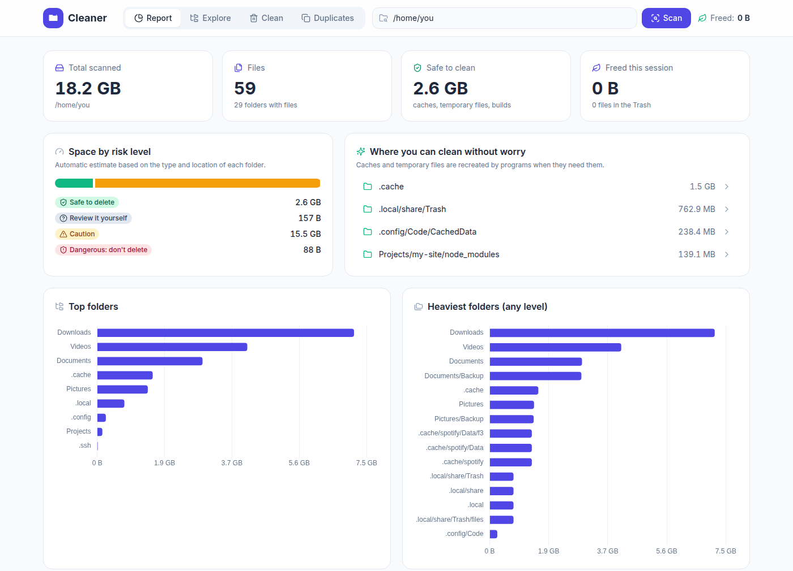
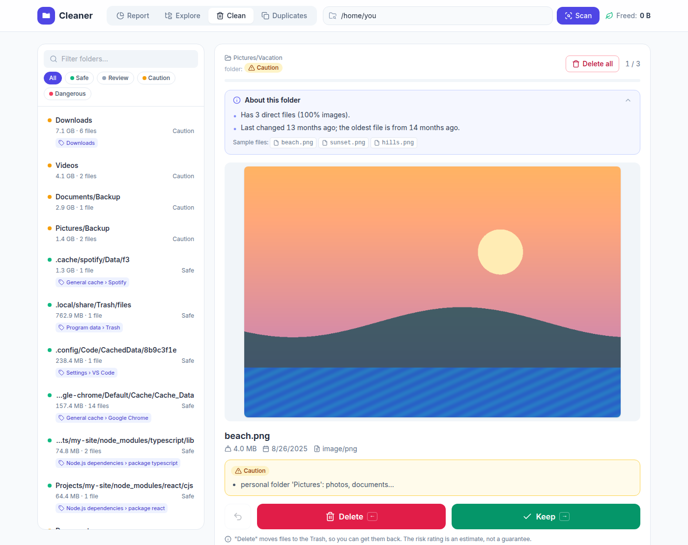
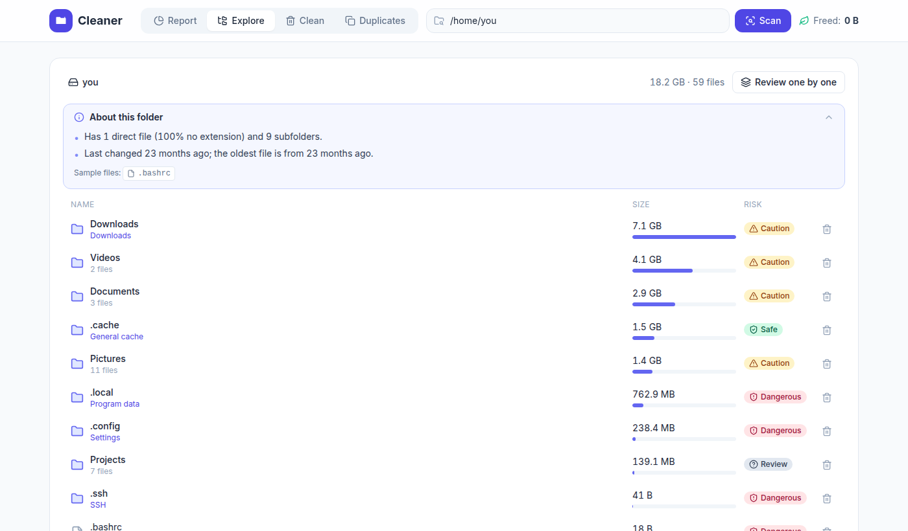
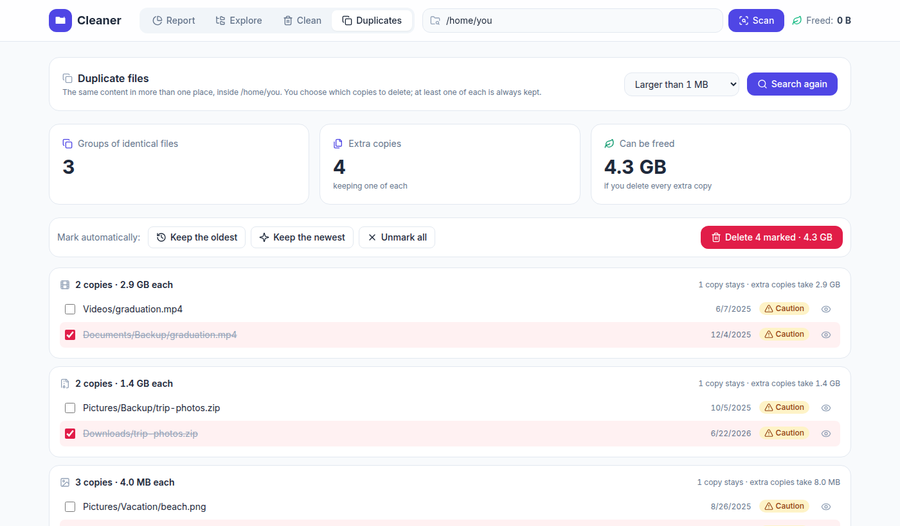

<div align="center">

# Cleaner

**See what's filling up your disk and clean it up safely, one file at a time.**




</div>

Your disk is full, but where did the space go? And is that folder called `.cache/spotify/Data/f3` safe to delete?

Cleaner scans a folder (your home folder by default) and opens a local page in your browser. It shows **where the space is going**, explains **what each folder is**, and rates every file from **Safe** to **Dangerous**, always with the reason. You decide what goes. Everything you delete goes to the system Trash, and you can undo it from the app.

- **Nothing is deleted for good.** Files go to the Trash on Linux, macOS and Windows, and **Undo** brings them back.
- **Nothing leaves your computer.** It runs locally with no internet connection, no account and no tracking.
- **Nothing to install besides Python.** No dependencies, and the interface works offline.

## Quick start

You need Python 3.10 or newer. Install Cleaner with [pipx](https://pipx.pypa.io) and run it:

```bash
pipx install git+https://github.com/eumarimariana/cleaner.git
cleaner
```

Your browser opens at `http://127.0.0.1:8765` and the scan starts. To scan another folder, pass it as an argument or type it in the box at the top of the page.

```bash
cleaner ~/Downloads        # scan a specific folder
cleaner --port 9000        # use another port
cleaner --no-browser       # don't open the browser automatically
```

> **macOS:** the first time you delete something, macOS asks whether Terminal may control Finder. Allow it so files go to the Finder Trash (and Finder's "Put Back" works).

## Features

| | |
|---|---|
| **Report** | Total space, space by risk level, the safest places to clean, the heaviest folders, usage by file type and the largest files. |
| **Risk rating** | Every file and folder is rated **Safe**, **Review**, **Caution** or **Dangerous**, with the reasons. |
| **About this folder** | Explains folders with odd names: which program created it, what it usually holds, which file type dominates and when it last changed. |
| **Clean** | Files show up one at a time, largest first, with a preview. Press `←` to delete and `→` to keep. |
| **Explore** | Browse folders like in a file manager, sorted by size, and delete straight from the list. |
| **Delete all** | Clear only the files in a folder, or the whole folder with its subfolders. Dangerous files are skipped unless you include them. |
| **Duplicates** | Finds files with the same content, even with different names, and marks the extra copies for you. At least one copy is always kept. |
| **Undo** | Click **Undo** or press `Ctrl+Z` (`⌘Z` on a Mac) and the last deletion comes back from the Trash. |

## Screenshots

<table>
  <tr>
    <td width="50%"><p align="center"><b>Clean</b>: review files one by one</p></td>
    <td width="50%"><p align="center"><b>Explore</b>: browse folders by size</p></td>
  </tr>
  <tr>
    <td colspan="2"><p align="center"><b>Duplicates</b>: find identical files and keep one copy of each</p></td>
  </tr>
</table>

## How to use it

### Clean screen shortcuts

| Key | Action |
|---|---|
| `←` or `Delete` | Delete (move to the Trash) |
| `→` | Keep |
| `Backspace` | Go back to the previous file. If you deleted it, it comes back from the Trash. |
| `Ctrl+Z` / `⌘Z` | Undo the last deletion (works on every screen) |

### Finding duplicates

On the **Duplicates** tab, pick a minimum size and click **Find duplicates**. Cleaner compares sizes first, then the start and end of each file, and finally the full content, so only identical files show up. **Keep the oldest** or **Keep the newest** marks all the extra copies at once. Dangerous files are never marked automatically.

### Where deleted files go

| System | Trash |
|---|---|
| Linux | The standard GNOME/KDE/XFCE Trash, through `gio` (or directly, if `gio` is not installed) |
| macOS | The Finder Trash |
| Windows | The Recycle Bin |

## How risk is rated

The ratings come from simple rules based on each file's **location** and **type**. They help you decide, but they are **not a guarantee**. When in doubt, check the preview.

| Level | Examples |
|---|---|
| **Safe** | `.cache`, `node_modules`, `__pycache__`, the Trash, logs, temporary files, unfinished downloads, installers (`.deb`, `.iso`, `.exe`) |
| **Review** | Files with no clue about what they are |
| **Caution** | Documents, Pictures, Videos, Downloads, archives, files changed in the last 30 days, files over 1 GB, installed games |
| **Dangerous** | `.ssh`, keys and passwords, `.git`, `.config`, browser profiles, dotfiles (`.bashrc`…), system files |

Deleting anything rated Dangerous always asks for confirmation.

## Privacy and security

- Everything runs on your computer. Cleaner makes no network requests, and the interface libraries ship with the project.
- The server only listens on `127.0.0.1`, so other devices can't reach it.
- Each session gets a random token, so other websites open in your browser can't use the API.
- Only paths inside the scanned folder are accepted.
- The scanned folder itself and your home folder can't be deleted as a whole, and at least one copy of each duplicate is always kept.

## Contributing

Bug reports and ideas are welcome in [Issues](https://github.com/eumarimariana/cleaner/issues). To run Cleaner from the source code:

```bash
git clone https://github.com/eumarimariana/cleaner.git
cd cleaner
python3 -m cleaner           # on Windows: py -m cleaner
python3 -m unittest -v       # run the tests
```

<details>
<summary>Project structure</summary>

```
cleaner/
├── cleaner/
│   ├── __main__.py     # command line
│   ├── server.py       # local HTTP server + JSON API
│   ├── scanner.py      # disk scan and size totals
│   ├── rules.py        # risk rating
│   ├── describe.py     # "About this folder" summary
│   ├── actions.py      # browse, list, move to the Trash and undo
│   ├── trash.py        # Linux, macOS and Windows Trash (move and restore)
│   ├── duplicates.py   # duplicate file search
│   ├── state.py        # in-memory state, undo history and path checks
│   ├── config.py       # port, token and constants
│   └── static/         # interface (HTML, CSS and JS)
│       └── vendor/     # Tailwind, Chart.js, Lucide and Inter, so it works offline
├── tests/              # automated tests
├── docs/screenshots/   # README images
└── pyproject.toml      # package info, used by pipx/pip install
```

</details>

### Roadmap

- [ ] Keep the undo history after closing the app

## License

MIT. See [LICENSE](LICENSE).
